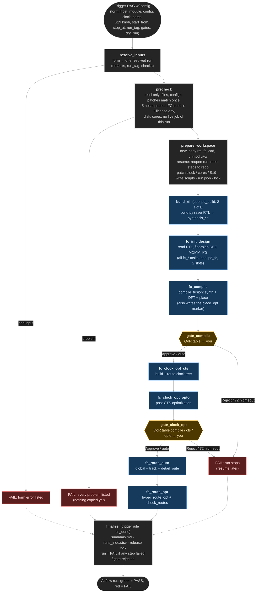
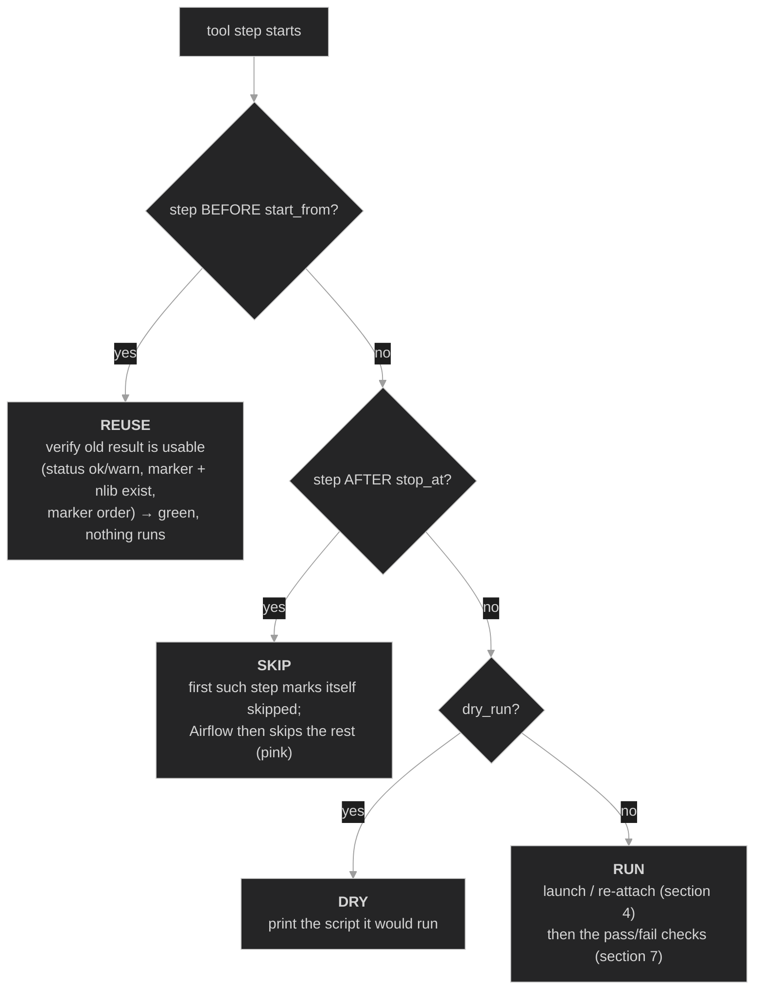
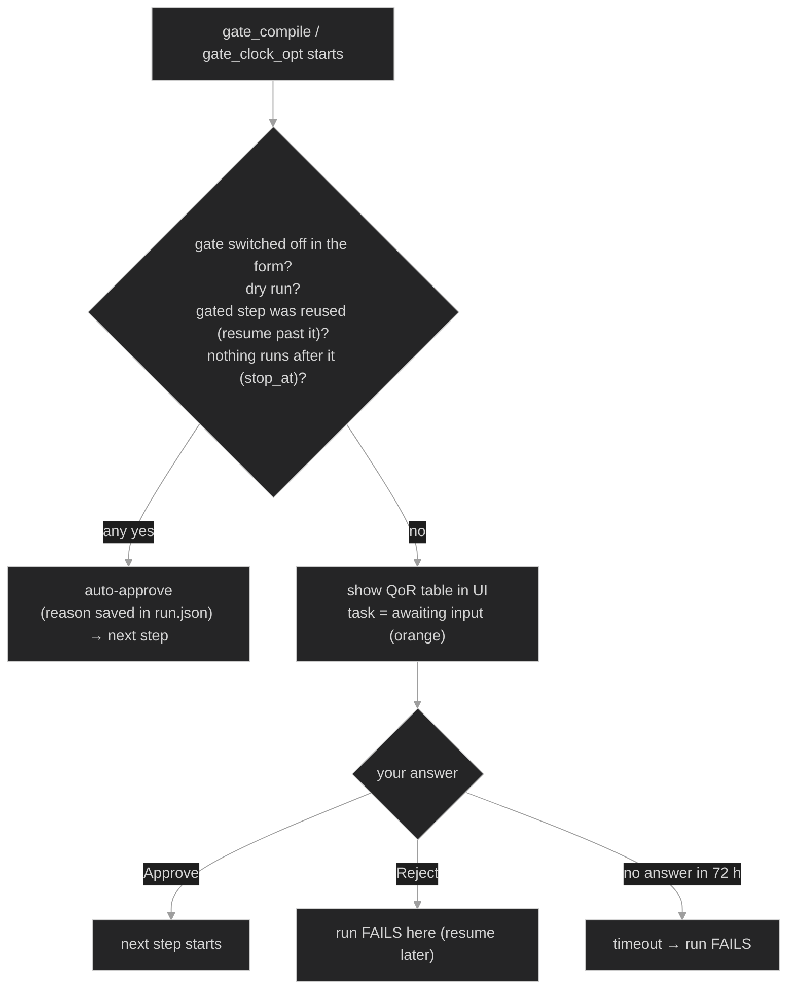
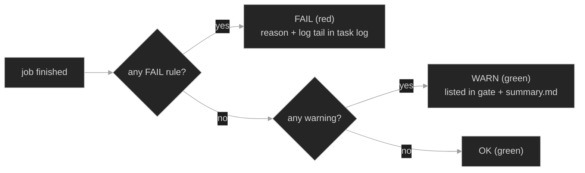
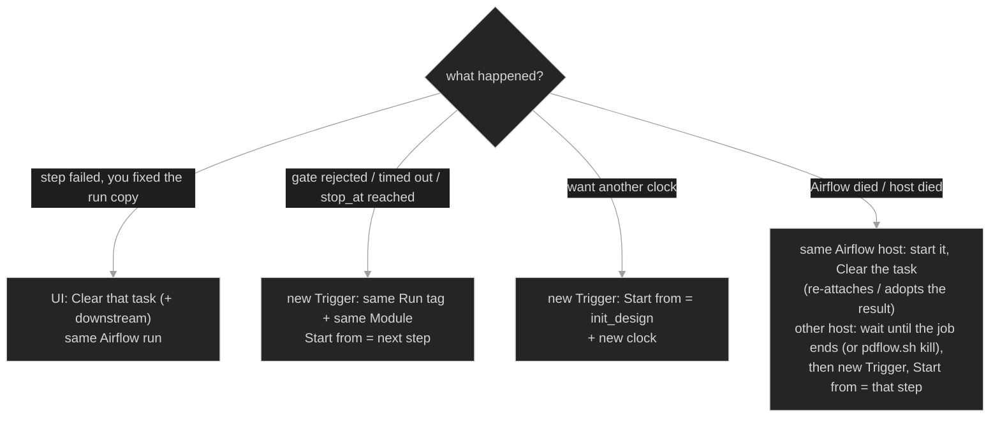

# raven_pd_flow — how the Airflow DAG runs a Fusion Compiler flow

> One Airflow run takes a Raven module from RTL build to **route_opt**. This page shows the DAG as a
> flow chart and explains every box: what it does, what it needs, what makes it pass or fail, and
> what it leaves on disk. Operator guide (start/stop, form, commands): `README.md` in the same folder.

**Contents**
1. [The big picture](#1-the-big-picture)
2. [The DAG flow chart](#2-the-dag-flow-chart)
3. [What decides how each step behaves](#3-what-decides-how-each-step-behaves)
4. [Inside one tool step](#4-inside-one-tool-step)
5. [Every task in detail](#5-every-task-in-detail)
6. [The review gates](#6-the-review-gates)
7. [Pass / warn / fail rules](#7-pass--warn--fail-rules)
8. [Resume, retry and recovery](#8-resume-retry-and-recovery)
9. [Where everything is written](#9-where-everything-is-written)
10. [Timeouts and observed runtimes](#10-timeouts-and-observed-runtimes)

---

## 1. The big picture

Three kinds of machine take part. Airflow only **orchestrates**; it never runs an EDA tool itself.

```mermaid
%%{init: {'theme': 'dark', 'themeVariables': {'background': '#1e1e1e', 'mainBkg': '#252526', 'primaryColor': '#2d2d30', 'primaryTextColor': '#d4d4d4', 'primaryBorderColor': '#6e6e6e', 'secondaryColor': '#2d2d30', 'tertiaryColor': '#1e1e1e', 'lineColor': '#9e9e9e', 'textColor': '#d4d4d4', 'clusterBkg': '#252526', 'clusterBorder': '#555555', 'edgeLabelBackground': '#1e1e1e', 'noteBkgColor': '#3a3d41', 'noteTextColor': '#d4d4d4', 'noteBorderColor': '#6e6e6e', 'actorBkg': '#2d2d30', 'actorBorder': '#6e6e6e', 'actorTextColor': '#d4d4d4', 'signalColor': '#d4d4d4', 'signalTextColor': '#d4d4d4', 'labelBoxBkgColor': '#2d2d30', 'labelTextColor': '#d4d4d4', 'loopTextColor': '#d4d4d4', 'activationBkgColor': '#3a3d41', 'fontFamily': 'Segoe UI, Ubuntu, sans-serif'}}}%%
flowchart LR
    U["You<br/>browser (Windows or VNC) / terminal"] -- "ssh tunnel :PORT (8081 for jsingh9)<br/>Trigger form, Approve/Reject" --> A
    subgraph A["Airflow host (a login server, e.g. mipscs83)"]
        S["scheduler + API/UI + triggerer<br/>DB: /var/tmp/jsingh9_pdflow_airflow_db"]
    end
    A -- "ssh mipspd8x /bin/sh -s<br/>(runs scripts/launch_STEP.sh; job starts DETACHED)" --> P
    subgraph P["pd host you chose (mipspd81..85)"]
        J["build.py / fc_shell<br/>own session (setsid)"]
    end
    J -- "logs, reports, status files" --> N[("shared NFS<br/>/home/jsingh9.scratch/raven_local_ws/RUN_TAG/")]
    A -- "reads status files + tails logs" --> N
```



```
 You (browser / terminal) ──tunnel :<port>──► Airflow host (login server, e.g. mipscs83)
                                                │  ssh: start job detached
                                                ▼
                                           pd host (mipspd81..85) runs build.py / fc_shell
                                                │  writes logs, reports, status files
                                                ▼
                 shared NFS  /home/jsingh9.scratch/raven_local_ws/<run_tag>/  ◄── Airflow reads them
```

* The job runs in its **own session** on the pd host, so it survives an Airflow restart, an ssh drop or
  closing your browser.
* Airflow learns what happened only from files on NFS (`status/<step>.{pid,start,rc,end}`, logs,
  reports) plus an occasional ssh "is it still alive?" check.
* Every run works on its **own copy** of `$MIPS_HOME/rm_fc_cad`; the Perforce workspace
  (`/home/jsingh9/Perforce/jsingh9_raven_ws2`) is only ever read.

---

## 2. The DAG flow chart

13 tasks in one straight chain. Two of them (`gate_*`) wait for you. `finalize` always runs.



Same chart in plain text:

```
 Trigger form
     │
     ▼
 resolve_inputs ── bad form ──────────────────────────────────────────────┐
     │                                                                     │
     ▼                                                                     │
 precheck ── any problem (nothing copied yet) ────────────────────────────┤
     │                                                                     │
     ▼                                                                     │
 prepare_workspace  (copy / reopen run, patches, scripts, run.json, lock)  │
     │                                                                     │
     ▼                                         ┌─ on pd host ─┐            │
 build_rtl ──────────────────────────────────► build.py        │  a FAILED  │
     ▼                                         │              │  tool step │
 fc_init_design ─────────────────────────────► fc_shell       │  stops the │
     ▼                                         │              │  chain ────┤
 fc_compile ─────────────────────────────────► fc_shell       │            │
     ▼                                         └──────────────┘            │
 ◆ gate_compile  (Approve → on | Reject / 72 h → stop) ───────────────────┤
     ▼                                                                     │
 fc_clock_opt_cts ──► fc_clock_opt_opto                                    │
     ▼                                                                     │
 ◆ gate_clock_opt (Approve → on | Reject / 72 h → stop) ──────────────────┤
     ▼                                                                     │
 fc_route_auto ──► fc_route_opt                                            │
     ▼                                                                     │
 finalize  (ALWAYS runs) ◄─────────────────────────────────────────────────┘
     │   summary.md, runs_index.tsv, release lock
     ▼
 Airflow run: green = PASS / red = FAIL
```

---

## 3. What decides how each step behaves

Every tool step (`build_rtl`, `fc_*`) first looks at `start_from` / `stop_at` / `dry_run` and picks
one of four modes:



```
 step BEFORE start_from ? ── yes ──► REUSE  (verify previous result, run nothing)
        │ no
 step AFTER stop_at ?    ── yes ──► SKIP
        │ no
 dry_run ?               ── yes ──► DRY    (show the script only)
        │ no
        └──────────────────────────► RUN    (launch on the pd host + checks)
```

Example — `start_from=route_auto`: build … clock_opt_opto are REUSE (green in seconds), both gates
auto-approve, route_auto and route_opt RUN.

---

## 4. Inside one tool step

What happens between "fc_compile starts" and "fc_compile is green/red":

```mermaid
%%{init: {'theme': 'dark', 'themeVariables': {'background': '#1e1e1e', 'mainBkg': '#252526', 'primaryColor': '#2d2d30', 'primaryTextColor': '#d4d4d4', 'primaryBorderColor': '#6e6e6e', 'secondaryColor': '#2d2d30', 'tertiaryColor': '#1e1e1e', 'lineColor': '#9e9e9e', 'textColor': '#d4d4d4', 'clusterBkg': '#252526', 'clusterBorder': '#555555', 'edgeLabelBackground': '#1e1e1e', 'noteBkgColor': '#3a3d41', 'noteTextColor': '#d4d4d4', 'noteBorderColor': '#6e6e6e', 'actorBkg': '#2d2d30', 'actorBorder': '#6e6e6e', 'actorTextColor': '#d4d4d4', 'signalColor': '#d4d4d4', 'signalTextColor': '#d4d4d4', 'labelBoxBkgColor': '#2d2d30', 'labelTextColor': '#d4d4d4', 'loopTextColor': '#d4d4d4', 'activationBkgColor': '#3a3d41', 'fontFamily': 'Segoe UI, Ubuntu, sans-serif'}}}%%
sequenceDiagram
    autonumber
    participant AF as Airflow task (login server)
    participant NFS as run dir on NFS
    participant PD as pd host (mipspd8x)
    AF->>NFS: read status/STEP.{pid,rc,launch,consumed}
    alt pid, no rc, ssh says session alive
        AF-->>AF: RE-ATTACH (no new launch)
    else pid, no rc, host unreachable
        AF-->>AF: FAIL: refuse to launch a possible duplicate
    else rc exists, launch never evaluated
        AF-->>AF: ADOPT its result
    else
        AF->>NFS: write status/STEP.launch (launch id)
        AF->>PD: ssh /bin/sh -s (exec scripts/launch_STEP.sh)
        PD-->>AF: "launched STEP pid N" (returns at once)
        PD->>NFS: sh session leader writes status/STEP.pid
        PD->>NFS: csh step script writes status/STEP.start
        Note over PD: in rm_fc_cad/MODULE/rm_fc/tmp: source env_fc.csh (module load fc/2022.12-SP6)<br/>rm this + later markers, rotate old log/rpts<br/>fc_shell -f ../../scripts_block/rm_fc_scripts/STEP.tcl >& ../logs/STEP.log
    end
    loop every 10 s until status/STEP.rc appears
        AF->>NFS: tail rm_fc/logs/STEP.log + logs/STEP.wrapper.log (errors, FLW-8001, license lines); soft-timeout check (active time)
        AF->>PD: every 2 min: is the session alive?
        AF-->>AF: every 5 min: heartbeat line (elapsed time, log size)
    end
    PD->>NFS: status/STEP.end, status/STEP.rc (atomic)
    AF->>NFS: run checks, parse reports → qor/STEP.json, run.json
    AF-->>AF: OK / WARN = green · FAIL = red
```

```
 Airflow task                          NFS run dir                         pd host
 ────────────                          ───────────                         ───────
 earlier job alive?  ── yes ─► RE-ATTACH (no duplicate launch)
 finished, never evaluated? ─► ADOPT result
 else: write status/<step>.launch
       ssh /bin/sh launch_<step>.sh ─────────────────────────────────────► setsid sh (session leader)
                                        ◄── status/<step>.pid ───────────    writes pid
                                        ◄── status/<step>.start ─────────  csh -f NN_<step>.csh
                                                                             source env_fc.csh
                                                                             rm markers ≥ step, rotate log/rpts
                                                                             fc_shell -f <step>.tcl >& logs/<step>.log
 every 10 s: tail log + soft-timeout check ◄── rm_fc/logs/<step>.log
 every 2 min: ssh "session alive?" ───────────────────────────────────────►
 every 5 min: heartbeat line
                                        ◄── status/<step>.end, .rc ──────  (written atomically)
 checks + parse reports ──────────────► qor/<step>.json, run.json
```

Details that matter:

| Item | How it works |
|---|---|
| Clean environment | the job starts with `env -i` + `PATH=/usr/local/bin:/usr/bin:/bin`; `env_fc.csh` does `module purge`, `module load fc/2022.12-SP6`, sets `MIPS_HOME`, `TECH_DIR`, `DESIGN_NAME`, `SYN_CONFIG`, license queueing; `DISPLAY` is unset (no GUI) |
| Wrong FC | the script refuses any `fc_shell` not under `/mips/tools/synopsys/FusionCompile/2022.12-SP6/` |
| No `make` | `fc_shell` is called directly (the RM Makefile's `\| tee` hides failures and `make` silently re-runs earlier steps; re-running init_design deletes the nlib). The equivalent `make` line is a comment in each script |
| Stale markers | before running, the script deletes this step's marker and all later ones, so an old marker can never make a failed re-run look finished |
| Old results kept | the previous `logs/<step>.log` and `rpts/<step>/` are renamed `.<timestamp>` |
| License queue | `SNPSLMD_QUEUE=true`, wait up to 12 h; this waiting time is **not** counted in the soft timeout |
| Killing | **Mark failed** in the UI kills the whole session on the pd host (TERM, KILL after 60 s) — but only if the Airflow API is healthy; an Airflow outage never kills a job. `bin/pdflow.sh kill <run_tag> [step]` works without Airflow (it only needs ssh to that pd host) |

---

## 5. Every task in detail

### 5.1 Setup tasks (seconds; no EDA tools)

| Task | Needs | Does | Passes when | Leaves |
|---|---|---|---|---|
| **resolve_inputs** | the form | DESIGN_NAME and top RTL come from the module; build config and clock, when blank, from the module defaults or (resume) from the run's `run.json`; makes the run tag `<module without _module>_<config>_<YYYYMMDD-HHmmss>` (dry runs: `dry-` prefix); checks combinations | inputs are consistent (host chosen, module chosen, start ≤ stop, resume has a tag and matching module/config, clock change only from init_design, no dry-run resume, tag without `verilog`/`sim_model`) | the resolved run (XCom) |
| **precheck** | resolved run | **read-only**: MIPS_HOME, rm_fc_cad, module dir, TECH_DIR, top RTL, build.py, source_env.csh, std-cell `.v`, every `<step>.tcl`, `<DESIGN>.func.sdc`, `<DESIGN>.FC.read_design.tcl`, DEF; `UNIFIED_FLOW true`; each patch matches exactly once; probes all 5 hosts (cores, load, RAM) and on yours runs `module load fc` in a clean env | no fatal problem (warnings are listed: busy host, other job on host, non-default build config, filelist override, missing optional lib paths) | host table in its log; warnings → saved by prepare_workspace as `precheck_warnings` in `run.json` |
| **prepare_workspace** | precheck OK | **new**: creates `<run_tag>/`, copies `rm_fc_cad`, makes it writable, hashes the source. **resume**: reopens the run, marks old finished results as used, resets steps to redo to *pending*, marks later steps *stale*. Then: patches (clock, cores, S19 knob), writes all scripts, writes `run.json`, takes the lock | copy/patch/scripts done | `rm_fc_cad/`, `scripts/`, `patches/<module>.diff`, `run.json`, `.pdflow.lock` |

### 5.2 Tool steps (each one runs on the pd host)

| Task | Tool command — FC steps run in `rm_fc_cad/<module>/rm_fc/tmp/` as `fc_shell -f ../../scripts_block/rm_fc_scripts/<step>.tcl < /dev/null >& ../logs/<step>.log` | Main reports in `rpts/<step>/` |
|---|---|---|
| **build_rtl** (pool `pd_build`) | in `rm_fc_cad/vbuild/`: `build.py ravenRTL -t <top> --configName <cfg> --workDirectory <cfg> -bt Synthesis -tech gf_22fdxp_9t_autopro150_9m_emram_stack -f <gf22 lvt .v> -f <std_primitives.v>` (env: `source_env.csh`, `IMGSITE=SC`) | `vbuild/<cfg>/build.log`, `vbuild/<cfg>/vbuild/py.Work/synthesis_{rtl,inc,pkg}.f` |
| **fc_init_design** (all fc_* : pool `pd_fc`) | `fc_shell -f init_design.tcl` — reads the build's filelists, elaborates `<DESIGN>`, reads DEF, MCMM, PG | `init_design.check_legality`, `.report_unbound`, `.report_ref_libs`, `.report_scenarios.rpt`; creates `<DESIGN>.nlib` |
| **fc_compile** | `fc_shell -f compile.tcl` — `compile_fusion` (logic opto, DFT insert, initial/final place). compile.tcl also saves the `place_opt` nlib label (unified flow); the step script then writes the `place_opt` marker | `compile.report_qor`, `.report_global_timing`, `.report_utilization`, `.report_timing.max`, `.qor.qor`, DFT `*.dft_drc`, `dft_drc_full.rpt` |
| **fc_clock_opt_cts** | `fc_shell -f clock_opt_cts.tcl` — build + route clock tree | `clock_opt_cts.report_qor`, `.report_clock_qor.summary`, `.check_routes`, … |
| **fc_clock_opt_opto** | `fc_shell -f clock_opt_opto.tcl` — post-CTS optimization | `clock_opt_opto.report_qor`, `.report_clock_qor.summary`, … |
| **fc_route_auto** | `fc_shell -f route_auto.tcl` — global/track/detail route, `check_routes` | `route_auto.report_qor`, `.check_routes` (DRCs, open nets), `.no_si.*`, … |
| **fc_route_opt** | `fc_shell -f route_opt.tcl` — `hyper_route_opt`, incremental route, `check_routes` | `route_opt.report_qor`, `.report_global_timing`, `.check_routes`, `.report_power`, … |

Each FC step copies the previous step's block label in `<DESIGN>.nlib` (`init_design → compile →
place_opt → clock_opt_cts → clock_opt_opto → route_auto → route_opt`).

### 5.3 finalize (always runs — trigger rule `all_done`)

| Does | Result |
|---|---|
| grades only a run dir that **this** Airflow run actually opened (otherwise: FAIL "failed before/at precheck or prepare_workspace", nothing rewritten) | |
| every step in `start_from … stop_at` must be `ok`/`warn` (`dry` in a dry run); a rejected/timed-out gate is listed first | PASS or FAIL |
| writes `summary.md`, adds a line to `runs_index.tsv`, records the result in `run.json` history, releases the run lock | |
| FAIL → the Airflow run turns red | |

---

## 6. The review gates



```
 gate switched off / dry run / step reused / nothing after it ? ── yes ──► auto-approve
        │ no
        ▼
 QoR table shown, task "awaiting input" ──► Approve → next step
                                        ├─► Reject  → run FAILS (resume later)
                                        └─► 72 h, no answer → run FAILS
```

| | gate_compile | gate_clock_opt |
|---|---|---|
| After | fc_compile | fc_clock_opt_opto |
| Shows | setup WNS/TNS/NVP, hold WNS/TNS, utilization, cell area, leaf cells, max-trans/cap, 5 worst path groups, Error IDs, S19 count, report/log paths, requested vs. confirmed clock and cores | the same, with columns compile │ clock_opt_cts │ clock_opt_opto |
| Answer in | UI: Browse → Required Actions, or the orange box → Approve/Reject (+comment) | same |
| Answer from terminal | `bin/pdflow.sh review <run_tag>` / `approve <run_tag> -m ".."` / `reject <run_tag> -m ".."` | same |
| Recorded | decision, user, time, comment → `run.json`, `summary.md` | same |

---

## 7. Pass / warn / fail rules

Exit codes alone are never trusted: the RM scripts keep running after Tcl errors (and still exit 0),
and `build.py` exits 0 in some failure cases.



**build_rtl FAILS if:** exit ≠ 0 · `build.log` does not end with `Build Completed` · `Error-[`,
` - ERROR - ` or a Python traceback in the log · `sim.Linux/sim` missing · a `synthesis_*.f` missing,
empty, stale, not listing the top file, or pointing into another run · peakrdl non-zero return code.

**An FC step FAILS if:**

| # | Rule | Catches |
|---|---|---|
| F1 | exit code ≠ 0, job lost, or soft timeout | crashes, kills |
| F2 | the step's marker (written by the **last line** of `<step>.tcl`) missing or older than the start | hard `exit` mid-script: *No clocks created*, *Rule S19* (knob off), missing read script |
| F3 | no *Thank you for using Fusion Compiler* | crash / kill |
| F4 | fatal patterns, or an ELAB / VER / LNK / NDM error in FC's message summary table | broken RTL read (e.g. corvi `rvn_inova` VER-294), license failure, segfault |
| F5 | FC echoed a different `Clk_period` / `-max_cores` than requested | patch had no effect |
| F6 | expected outputs missing/stale (`.nlib`; `report_qor`, `report_global_timing`) | step did not really run |
| F7 | `report_qor` has no `Clk` group, or its period ≠ requested | clock not constrained as asked |
| route_opt | any **open net** | incomplete routing |

**WARN (still green):** other `Error:` IDs (a good run has some, e.g. `CMD-015`, `SEL-005`) ·
`RM-error` lines · DFT S19 continued (knob on) · DRCs after routing · open nets after route_auto ·
missing `qor.qor`.

---

## 8. Resume, retry and recovery



| Situation | Start from |
|---|---|
| a step failed | that step (after fixing the cause) |
| rejected / timed out at gate_compile | `clock_opt_cts` |
| rejected / timed out at gate_clock_opt | `route_auto` |
| different clock period | `init_design` |
| finished with an earlier `stop_at` | the next step |
| Airflow moved to another host while a job was running | wait until the job ends (`pdflow.sh list --live`), then that step (precheck refuses while it still runs) |

Rules: same **Run tag**, same **Module** (a different one is refused); build config and clock are
taken from the run when left blank. Earlier steps are *reused* (verified, not re-run); the gates of
reused steps auto-approve.

---

## 9. Where everything is written

Run folder: **`/home/jsingh9.scratch/raven_local_ws/<run_tag>/`**

```
<run_tag>/
├── summary.md                  PASS/FAIL, step table, gates, paths            ← start here
├── run.json                    inputs, fixed-config snapshot, per-step status/facts, gates, history
├── patches/<module>.diff       what was changed in the copy (clock, cores, S19 knob)
├── scripts/                    10_build.csh … 70_route_opt.csh, env_fc.csh, env_build.csh, launch_<step>.sh
├── status/<step>.{pid,start,end,rc,launch,consumed}   host + pid, times, exit code
├── logs/                       build.console.log, build.source_env.log, <step>.wrapper.log
├── qor/<step>.json             parsed QoR per step
├── src_manifest.sha256         proof the Perforce source was not modified
└── rm_fc_cad/                  the run's own copy of $MIPS_HOME/rm_fc_cad
    ├── vbuild/<config>/build.log, vbuild/py.Work/synthesis_{rtl,inc,pkg}.f
    └── <module>/rm_fc/
        ├── logs/<step>.log     FC logs
        ├── rpts/<step>/        FC reports
        ├── work/               svf, scandef, dcg.def, …
        └── tmp/<DESIGN>.nlib   design library + step markers
```

Across all runs: `/home/jsingh9.scratch/raven_local_ws/runs_index.tsv` (one line per finished run).
Project (code, config, docs): `/home/jsingh9.scratch/mywork/pd_flow_airflow/` — predefined values in
`config/fixed.yaml`, DAG in `airflow/dags/raven_pd_flow_dag.py`, logic in `pdflow/`.

---

## 10. Timeouts and observed runtimes

**Soft timeouts** (job is killed after this much *active* time; license queueing up to 12 h is extra),
from `config/fixed.yaml` → `timeouts_h`:

| size (modules) | build | init_design | compile | clock_opt_cts | clock_opt_opto | route_auto | route_opt |
|---|---|---|---|---|---|---|---|
| S (debug, trf) | 1 h | 2 h | 4 h | 2 h | 2 h | 4 h | 4 h |
| M (cic) | 1 h | 4 h | 12 h | 8 h | 8 h | 12 h | 12 h |
| L (corvi) | 1 h | 6 h | 24 h | 16 h | 16 h | 24 h | 24 h |

Airflow's own last-resort limit per step = largest soft timeout + 12 h (license) + 2 h.

**Observed** (debug_module `debug_2Core_4VC_32K_rvn_drive_20260930-001616` on mipspd81, 16 cores):

| step | runtime | result |
|---|---|---|
| build | 1 min | OK |
| init_design | 13 min | WARN |
| compile | 10 min | WARN (S19 continued, knob on) |
| clock_opt_cts | 5 min | WARN |
| clock_opt_opto | 14 min | OK |
| route_auto | 33 min (6 min of it fc_shell start-up / license) | WARN (304 DRCs, 0 open nets) |
| route_opt | 22 min | WARN (399 DRCs, 0 open nets) — final setup WNS −0.389, hold WNS −0.141 |
| **total FC time** | **~1 h 40 min** + review time at the gates | **PASS** |

Other observations: trf_module build 0.5 min, init_design 3 min; corvi_module (config `rvn_inova`)
init_design ran 1 h 22 min and **failed** on RTL read errors (VER-294/VER-260, 57 unbound modules).
