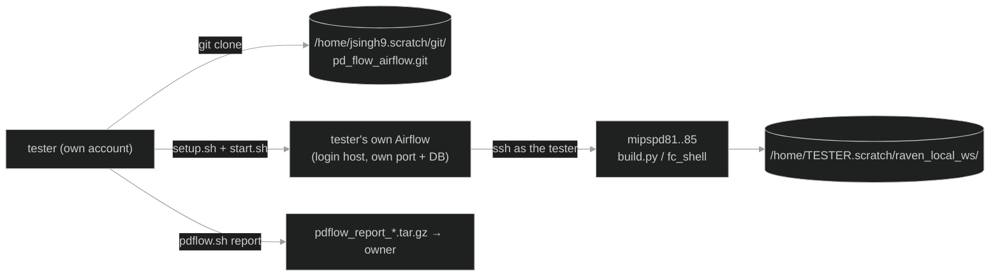

# Sharing raven_pd_flow — how colleagues can try it, test it and report errors

> **Short answer:** each person runs **their own Airflow instance under their own account** — either from
> their own clone (way A, ~20 min, needs internet for `pip`) or, simpler, straight from the owner's install
> with `bash /home/jsingh9.scratch/mywork/pd_flow_airflow/bin/pdflow-user-setup.sh` (way A′, 1 min: no clone,
> no pip, no venv copy; your settings live in `~/.pdflow/`). Nothing is opened to the internet, nothing runs
> as somebody else, and every problem comes back as one `pdflow_report_*.tar.gz` file.
> Code: `/home/jsingh9.scratch/mywork/pd_flow_airflow/` · clone from `/home/jsingh9.scratch/git/pd_flow_airflow.git`
> · the owner's Airflow runs on **mipspd86** (since 2026-10-14).

**Contents**
1. [All the ways, compared](#1-all-the-ways-compared)
2. [What every tester needs](#2-what-every-tester-needs)
3. [Step by step (the recommended way)](#3-step-by-step-the-recommended-way)
4. [How to report an error](#4-how-to-report-an-error)
5. [Known issues — errors you may hit and what to do](#5-known-issues--errors-you-may-hit-and-what-to-do)
6. [Updates, and where things are](#6-updates-and-where-things-are)
7. [The other ways in more detail](#7-the-other-ways-in-more-detail)

---

## 1. All the ways, compared

| | Way | What it needs | Good for | Verdict |
|---|---|---|---|---|
| **A′** | **Own Airflow from the shared install** (`bin/pdflow-user-setup.sh` → `start.sh` → ssh tunnel) | a MIPS Linux account, passwordless ssh to mipspd81-85, `module load fc` working, 50-150 GB for runs | real testing: runs use *their* account, licenses, scratch; no install step, always the current code | **Recommended** |
| **A** | **Each tester runs their own clone** (git clone → `setup.sh` → `start.sh` → ssh tunnel) | as A′ plus internet access for `pip` and ~300 MB for the venv | the same, plus hacking on the code | fine for developers |
| **B** | Open one Airflow on the intranet (`AIRFLOW__API__HOST=0.0.0.0`, a login per person) | the host's port reachable from other machines; a role per person (VIEWER / USER / OP / ADMIN) | showing the UI, watching runs | demo only — every FC job runs **as the owner** (`jsingh9`), in the owner's scratch, with the owner's ssh keys |
| **C** | ssh tunnel to the owner's Airflow, using the owner's login | ssh to the Airflow host | a quick look | same caveat as B, and one shared password |
| **D** | IT-hosted team service (service account, Postgres, company SSO via the FAB auth provider, HTTPS reverse proxy, worker hosts) | IT + security review, a service account with FC access | a permanent team tool | later, if the team adopts it |
| **E** | Internet tunnels (ngrok, cloudflared, router port-forward, public cloud) | — | — | **not allowed**: it would expose a tool that runs shell jobs on company servers and shows proprietary RTL/Perforce paths and design reports |



```
 tester ──git clone──► /home/jsingh9.scratch/git/pd_flow_airflow.git
   │
   ├─ setup.sh + start.sh ──► the tester's OWN Airflow (own port, own DB, own login)
   │                              │ ssh as the tester
   │                              ▼
   │                          mipspd81..85 run build.py / fc_shell
   │                              │
   │                              ▼
   │                          /home/<tester>.scratch/raven_local_ws/<run_tag>/
   └─ pdflow.sh report <run_tag> ──► one .tar.gz back to the owner
```

---

## 2. What every tester needs

| Need | Why | How to check / fix |
|---|---|---|
| A MIPS Linux account with a scratch area (`/home/<you>.scratch`) | runs (copies of rm_fc_cad, nlib, reports) go there | `ls -d /home/$USER.scratch` |
| A host with `/usr/bin/python3.11` and tmux | Airflow runs on it. **Prefer a compute host** (mipspd86, mipspd81): the login servers mipscs82/83 freeze under load and killed the scheduler twice. mipspd82 has no python3.11 | `ls /usr/bin/python3.11` |
| **Passwordless ssh** from that host to mipspd81 … mipspd85 | every build/FC step is started there over ssh | `ssh -o BatchMode=yes mipspd81 hostname` — if it asks for a password: `ssh-keygen -t ed25519` (Enter ×3) then `cat ~/.ssh/id_ed25519.pub >> ~/.ssh/authorized_keys`; ssh once to each host by hand to accept its key |
| `module load fc/2022.12-SP6` works for you on the pd hosts | the FC steps use it | `doctor` checks it |
| Read access to a Raven Perforce workspace | the flow copies `rm_fc_cad` and reads the RTL | default is `/home/jsingh9/Perforce/jsingh9_raven_ws2` (readable by everyone); set your own in `config/local.yaml` |
| Disk: ≥ 50 GB for runs (corvi: ~150 GB; a corvi run dir is 5-8 GB); way A also ~300 MB for the venv | | `doctor` shows free space |
| An ssh tunnel from your desktop / VNC / laptop to the login host | the UI only listens on the login host itself | printed by `start.sh` |

**One command checks all of it:**

```csh
bash /home/jsingh9.scratch/mywork/pd_flow_airflow/bin/pdflow.sh doctor      # (or your clone's bin/pdflow.sh)
#   before you start Airflow:  "... 0 FAIL" with 2-3 WARN (not running / DAG not registered / log ports) is normal
#   with Airflow running:      "N checks: N PASS, 0 WARN, 0 FAIL" -- every FAIL line says how to fix it
```

---

## 3. Step by step

### 3a. Way A′ — your own Airflow from the shared install (recommended, ~1 min)

Use a compute host with python 3.11 and tmux (`mipspd86` or `mipspd81`). Commands are csh.

```csh
# 1. one-time: write ~/.pdflow/local.env (your ports, your instance dir, the shared venv) + ~/.pdflow/local.yaml,
#    then run doctor. Re-run any time; it keeps your files (--force rewrites them).
bash /home/jsingh9.scratch/mywork/pd_flow_airflow/bin/pdflow-user-setup.sh

# 2. (optional) edit ~/.pdflow/local.yaml: mips_home = your own Perforce workspace, runs_root, fc_hosts

# 3. start YOUR Airflow (inside tmux so it keeps running after you log out)
tmux new -s pdflow 'bash /home/jsingh9.scratch/mywork/pd_flow_airflow/airflow/start.sh'
#    it prints your port (20000 + uid % 20000), the tunnel command and where the password is.
#    detach: Ctrl-b d      back: tmux attach -t pdflow

# 4. on the machine with your browser (VNC desktop, or Windows PowerShell):
ssh -f -N -L <port>:127.0.0.1:<port> <that host>
#    open http://127.0.0.1:<port>   user: admin   password: cat ~/.pdflow/home/simple_auth_manager_passwords.json.generated
```

What is yours: the Airflow processes, port, metadata DB (`/var/tmp/<you>_pdflow_airflow_db` on that host), instance
dir `~/.pdflow/home` (airflow.cfg, task logs, password), runs under `/home/<you>.scratch/raven_local_ws/`. What is
shared and read-only for you: the code, the venv, `config/fixed.yaml`. `git pull` by the owner updates everyone's
code at the next DAG parse (≤ 1 min); restart your Airflow after a pull that changes `env.sh`.

### 3b. Way A — your own clone (developers)

```csh
# 1. get the code (into your own home or scratch)
cd /home/$USER.scratch
git clone /home/jsingh9.scratch/git/pd_flow_airflow.git
cd pd_flow_airflow

# 2. (optional) your own settings -- only what you change
cp config/local.yaml.example config/local.yaml      # e.g. mips_home: your own Perforce workspace
cp airflow/local.env.example airflow/local.env      # e.g. a fixed port, or VENV=<shared venv>

# 3. install Airflow (once, ~5 min, ~300 MB; needs PyPI + raw.githubusercontent.com). Shortcut: put
#    export VENV=/home/jsingh9.scratch/mywork/pd_flow_airflow/airflow/venv   in airflow/local.env
#    to reuse the owner's install instead (read-only).
bash airflow/setup.sh

# 4. check everything (2-3 WARN before Airflow runs is normal)
bash bin/pdflow.sh doctor

# 5. start Airflow (inside tmux so it keeps running after you log out)
tmux new -s pdflow 'bash /home/'$USER'.scratch/pd_flow_airflow/airflow/start.sh'
#    detach: Ctrl-b d      back: tmux attach -t pdflow

# 6. on the machine with your browser (VNC desktop, or Windows PowerShell):
ssh -f -N -L <port>:127.0.0.1:<port> <host>
#    open http://127.0.0.1:<port>   user: admin
#    password: cat /home/$USER.scratch/pd_flow_airflow/airflow/home/simple_auth_manager_passwords.json.generated
```

Then test in this order (UI → **raven_pd_flow** → **Trigger**):

| # | Test | Form | Expect | Time |
|---|---|---|---|---|
| 1 | form check | leave **pd host** empty | resolve_inputs fails at once: *"fc_host is required …"* | seconds |
| 2 | dry run | host `mipspd81`, module `debug_module`, **Dry run** on | all 13 boxes green, nothing launched | 1 min |
| 3 | small real run | `debug_module`, **Stop after** `compile`, **Continue past DFT Rule S19** on | build ✓ init_design ✓ compile ✓ | ~20 min |
| 4 | full run | `debug_module`, Stop after `route_opt`, gates on | pauses at **gate_compile** and **gate_clock_opt** (Approve in *Browse → Required Actions*), ends PASS | ~1.5 h |
| 5 | your module | corvi / cic / trf as you need | | hours |

What "working" looks like and what each box does: see `FLOW.md`; the form fields: `README.md` §2.

---

## 4. How to report an error

1. Note **which run** (run tag), **which task** (red box), **which host**, and **what you expected**.
2. Make the report bundle (one file, ~100 KB; logs are tails, no design databases):

```csh
bash /home/$USER.scratch/pd_flow_airflow/bin/pdflow.sh report <run_tag>
#   report written: /home/<you>.scratch/raven_local_ws/<run_tag>/pdflow_report_<time>.tar.gz
```

3. Send the **path** (it is on shared NFS) or the file to the owner (jsingh9) with the notes from 1.

The bundle contains `summary.md`, `run.json`, `patches/`, `status/`, `qor/`, the Airflow task logs of
that run, the last 300 lines of each FC/build log, `doctor` output and the code version (git commit).

If Airflow itself misbehaves (no Trigger button, nothing starts), also send the output of
`bash airflow/status.sh` and the last 200 lines of the tmux window (`tmux attach -t pdflow`; or start Airflow as
`tmux new -s pdflow "bash -c 'bash .../airflow/start.sh 2>&1 | tee -a .../airflow/standalone.$HOST.log'"` to keep a log file).

---

## 5. Known issues — errors you may hit and what to do

| Symptom | Cause | What to do |
|---|---|---|
| UI has **no Trigger button**, or runs stay *queued* | the login host was frozen/overloaded; Airflow's scheduler or DAG reader stopped (DAG marked "stale") | `bash airflow/status.sh`; if anything is unhealthy: `bash airflow/stop.sh` then start again in tmux. Running FC jobs are **not** affected. |
| Runs stay **queued** on a brand-new copy | Airflow creates a DAG *paused* in a new database | fixed: new DBs create it unpaused and `start.sh` unpauses it; `doctor` reports *"DAG raven_pd_flow not paused: FAIL"* with the fix if it ever happens |
| `pdflow.sh` says *"…/airflow/venv/bin/python: No such file or directory"* | an old copy that ignored `VENV` from `local.env` | `git pull` (fixed) |
| A step's log shows *"task stopped by Airflow … NOT killing the job"* | Airflow lost contact (host freeze/restart) | nothing: the step is retried automatically and re-attaches to the job (log: *REATTACHED* / *ADOPTED*) |
| init_design log is **empty for 5-10 min** | fc_shell start-up / waiting for a license (queueing is on, up to 12 h) | wait; the task log says *"[waiting for license/start-up]"* |
| compile FAILS with *"Rule S19 violation exists and hence exiting"* | the RM stops on DFT Rule S19 (debug, trf hit it) | trigger again: same Run tag, **Start from** `compile`, **Continue past DFT Rule S19** on |
| corvi init_design: VER-294 / VER-260, 57 unbound modules | an RTL macro FC can't parse (`RVN_EXCTYPE_SIZE`) | fixed automatically in the run copy (`rtl_fixes` in `config/fixed.yaml`); log shows *"rtl fix … applied"* |
| *"Host key verification failed"* | first ssh to that host under that name | `ssh <host>` once by hand and answer `yes` (use short names: `mipspd81`) |
| precheck: *"locked by Airflow run … on host X"* | a previous run of the same tag is still active, or it ran under an Airflow on another host (whose DB cannot be consulted) | same host: finish/mark it failed first (a finished run's lock is taken over automatically); other host: `rm <run>/.pdflow.lock` as the message says |
| precheck WARN *"start_from=X RE-RUNS that step"* | you resumed *at* a step that already finished and was graded | use Start from = the next step, unless you really want to redo it |
| *"run … is X, not Y"* on resume | the Module must be the run's own module | pick the same module as the run |
| precheck WARN *"host busy"* / *"wants >= N GB RAM"* | the pd host is loaded | pick another pd host (doctor shows load and free RAM of all five) |
| port already in use / tunnel fails | someone uses your port | set `AIRFLOW_PORT` in `airflow/local.env`, restart |
| `tmux new … 'cmd 2>&1 | tee …'` dies at once | tmux runs the command with your login shell (csh) | wrap it: `tmux new -s pdflow "bash -c '…'"` or keep the plain form from step 5 |
| Gate waits forever | gates need a human: Approve/Reject | *Browse → Required Actions*, or `bin/pdflow.sh approve <run_tag> -m "…"`; no answer in 72 h → the run fails |
| Run tag rejected (pattern) | spaces inside the tag | copy the tag exactly; leading/trailing spaces are fine |

Debug_module reference (2026-10-07, mipspd81, 16 cores): whole flow ~1 h 20 min, route_opt setup WNS
−0.382 ns, hold WNS −0.129 ns, 383 DRCs, 0 open nets, PASS.

---

## 6. Updates, and where things are

**Getting updates:** `cd /home/$USER.scratch/pd_flow_airflow; git pull` then restart Airflow
(`bash airflow/stop.sh`, start again). Your `config/local.yaml` and `airflow/local.env` are never
overwritten (git-ignored).

**Publishing updates (owner):** commit in `/home/jsingh9.scratch/mywork/pd_flow_airflow`, then
`git push shared main`.

| What | Where |
|---|---|
| Code to clone | `/home/jsingh9.scratch/git/pd_flow_airflow.git` |
| Owner's working copy | `/home/jsingh9.scratch/mywork/pd_flow_airflow/` |
| Your copy (suggested) | `/home/<you>.scratch/pd_flow_airflow/` |
| Your runs | `/home/<you>.scratch/raven_local_ws/<run_tag>/` (`summary.md` first) |
| Your Airflow DB | `/var/tmp/<you>_pdflow_airflow_db/` on the host you started it on |
| Your instance (way A′) | `~/.pdflow/home/` (airflow.cfg, task logs, admin password) + `~/.pdflow/local.env` |
| Settings | `config/fixed.yaml` (shared) + `config/local.yaml` or `~/.pdflow/local.yaml` (yours; the latter wins) |
| Docs | `README.md` (operator guide), `FLOW.md` (how the DAG works), `TEAM_ROLLOUT.md` (status + rollout plan), this file |

---

## 7. The other ways in more detail

**B — one shared Airflow on the intranet (demo).** In the owner's `airflow/local.env` (honoured by `env.sh` since
2026-10-14; before that these two were overwritten):

```sh
export AIRFLOW__API__HOST=0.0.0.0                                    # listen for other machines
export AIRFLOW__API__BASE_URL=http://mipspd86.mipstec.com:8081       # links in the UI
export AIRFLOW__CORE__SIMPLE_AUTH_MANAGER_USERS="admin:admin,alice:viewer,bob:user"
```

Restart; passwords for each name are generated into `airflow/home/simple_auth_manager_passwords.json.generated`.
Others open `http://mipspd86.mipstec.com:8081` (only if the network lets that port through).
Roles: **VIEWER** read-only, **USER** can trigger/clear runs, **OP** also pools/variables, **ADMIN**
everything. Caveat: whatever anyone triggers runs **as the owner**, in the owner's scratch, with the
owner's ssh keys and FC licenses — fine for a demo, not for testing.

**C — tunnel to the owner's instance.** `ssh -f -N -L 8081:127.0.0.1:8081 <owner's Airflow host>`
and the owner's admin password. Quickest look; same caveat as B.

**D — team service.** A service account owns Airflow and the run area; Postgres instead of SQLite;
the FAB auth manager (`apache-airflow-providers-fab`) for company login/LDAP; an HTTPS reverse proxy;
the scheduler on a stable (non-login) server, FC steps unchanged (ssh to pd hosts as the service
account). Needs IT for the account, hosting and a security review.

**E — internet exposure: don't.** No ngrok/cloudflared/port-forwarding: the UI can launch shell jobs
on company servers and shows design data. Everything above stays inside the MIPS network.
